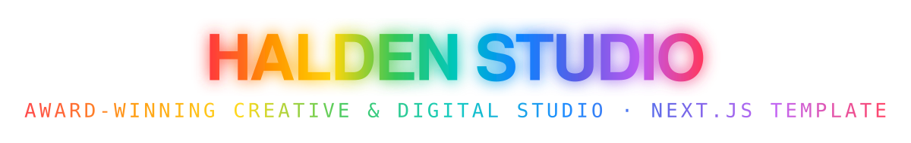
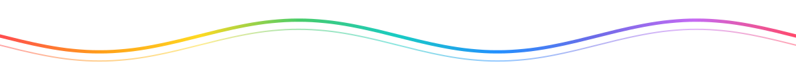
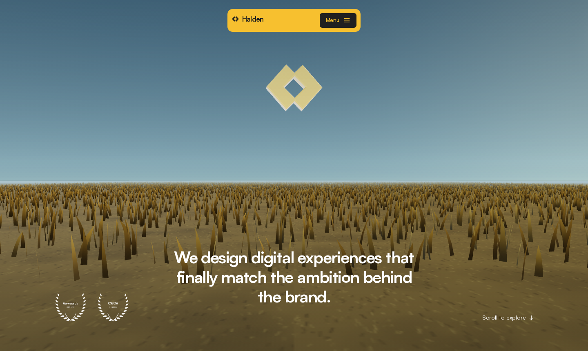
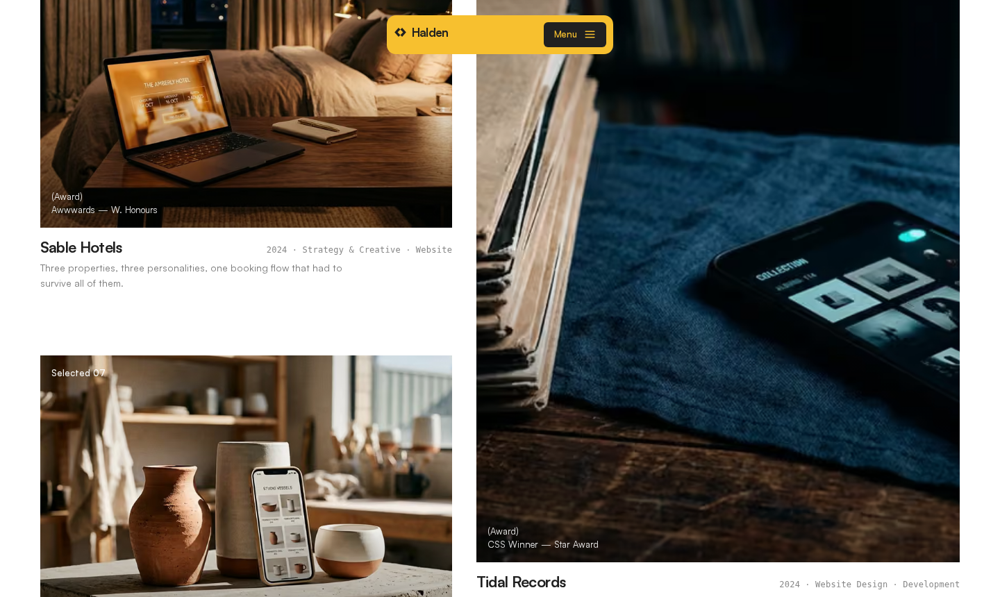
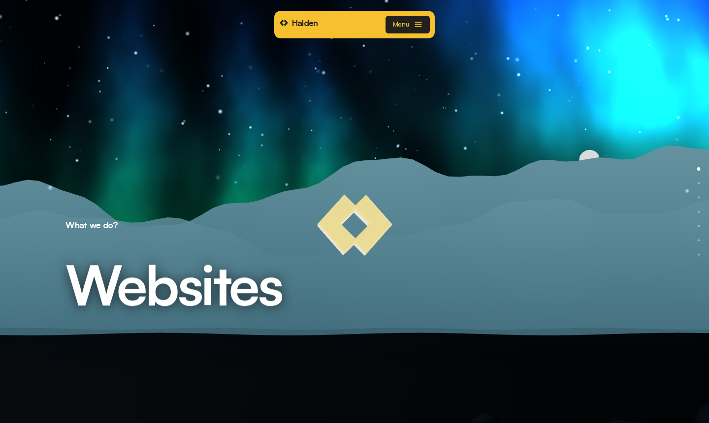
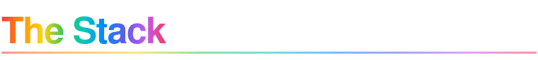
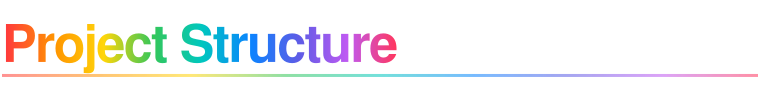
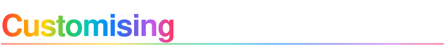
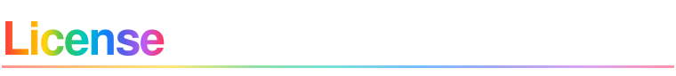

<div align="center">



<br />

<p align="center">
  <a href="https://github.com/your-username/halden-studio"></a>
  <a href="https://github.com/your-username/halden-studio"></a>
  <a href="https://github.com/your-username/halden-studio"></a>
  <a href="https://github.com/your-username/halden-studio"></a>
  <a href="https://github.com/your-username/halden-studio"></a>
  <a href="https://github.com/your-username/halden-studio"></a>
  <a href="https://github.com/your-username/halden-studio"></a>
</p>

<p align="center">
  <b>Scroll-driven storytelling portfolio</b><br />
  <sub>Three.js hero · Scroll-triggered GSAP timelines · Lenis smooth scrolling · Custom canvas cursor</sub>
</p>

<br />



</div>

---

## About

**Halden** is a production-ready portfolio template for independent creative and digital studios. It is built around a single idea: **the scroll position is the narrative**.

The homepage is not a stack of sections. It is one continuous composition — a 3D grass field in the hero that recedes toward a coastline, a scroll-pinned coastal sequence that explains the process, a masonry work gallery, an awards wall, and a WebGL aurora finale — with the page's own pacing designed to be felt rather than read.

Everything in this repository is original: the copy, the identity, the project names, the imagery, the SVG component library, and the shaders. Nothing is lifted from the reference site it was modelled on.



<p align="center">
  
  
</p>

---


<table>
<tr>
<td width="50%" valign="top">

**🧠 Three-dimensional hero**

A real WebGL scene, not a video. 30,000 instanced grass blades — tapered, curved, and bending under a scrolling wind field — over a mottled earth plane, with a teal sky and a polished extruded brand mark. Pointer movement parallax-es the camera.

Two more scenes follow it: a **coastline** with animated surf, layered peaks and standing gold monoliths, and a **night aurora** with GLSL curtains over a silhouetted ridge.

</td>
<td width="50%" valign="top">

**🎬 Scroll as the timeline**

GSAP `ScrollTrigger` pins sections, scrubs timelines and drives every reveal. The homepage is 19,000px of deliberate pacing — you feel the argument before you read it.

</td>
</tr>
<tr>
<td valign="top">

**🖱️ A cursor that belongs to the site**

A yellow pointer rendered on a `<canvas>` that trails with spring physics and grows a halo over interactive elements. Hidden on touch devices, fully disabled under `prefers-reduced-motion`.

**📐 Pinned scroll sequences**

Two sections pin themselves to the viewport while the page scrolls underneath — the coast sequence and the aurora finale — so the camera keeps moving while the copy changes. Together they carry ~19,000px of deliberate pacing.

</td>
<td valign="top">

**🌌 WebGL finale**

A shader-driven aurora curtain over a low-poly mountain ridge, with the service list cycling against it and a draggable stage. Written in raw GLSL, tuned for mid-range GPUs.

</td>
</tr>
<tr>
<td valign="top">

**🧩 A real design system**

Tailwind v4 tokens in CSS, a shared spacing and type scale, and a component library of hand-authored SVG marks — laurel wreaths, client wordmarks, social glyphs, interface icons.

</td>
<td valign="top">

**🧭 Page transitions**

A canvas tile-shutter wipes between routes. Navigating feels like turning a page rather than reloading a document.

</td>
</tr>
<tr>
<td valign="top">

**⚡ Performance aware**

Static generation on every route, self-hosted subsetted fonts, `next/image` everywhere, intersection-aware Three.js scenes that pause when off-screen, and a reduced-motion path for each animation.

</td>
<td valign="top">

**🌍 Built to be extended**

One content file drives navigation, projects, clients, awards, services and the CTA. Change `src/data/site.ts` and the entire site follows.

</td>
</tr>
</table>

---



<table>
<tr><th align="left">Layer</th><th align="left">Choice</th><th align="left">Why</th></tr>
<tr><td>Framework</td><td><b>Next.js 15</b> (App Router)</td><td>Static export, nested layouts, streaming, and metadata APIs that just work.</td></tr>
<tr><td>Language</td><td><b>TypeScript 5</b></td><td>Strict mode, with the content model typed end to end.</td></tr>
<tr><td>Styling</td><td><b>Tailwind CSS 4</b></td><td>CSS-first tokens, no config file, and arbitrary values where a layout needs them.</td></tr>
<tr><td>Animation</td><td><b>GSAP 3</b> + <b>ScrollTrigger</b> + <b>SplitText</b></td><td>Scrubbed timelines, pinned sections and line-by-line text reveals.</td></tr>
<tr><td>Smooth scroll</td><td><b>Lenis</b></td><td>Interpolates wheel, touch and keyboard scrolling into one smooth value.</td></tr>
<tr><td>3D</td><td><b>Three.js</b></td><td>Instanced grass, custom GLSL aurora, and a lit extruded brand mark.</td></tr>
<tr><td>Icons</td><td><b>Hand-authored SVG</b></td><td>No icon package, no runtime cost, and full control of the stroke weight.</td></tr>
<tr><td>Fonts</td><td><b>Satoshi</b> + <b>DM Mono</b></td><td>Self-hosted WOFF2, subset and preloaded — no third-party request.</td></tr>
</table>

---


### Prerequisites

- **Node.js 18.18+** (Node 20 LTS recommended)
- **npm 9+** or **pnpm**
- A modern browser — the WebGL scenes need WebGL 2 for the aurora, and degrade gracefully without it

### 1 · Clone and install

```bash
git clone https://github.com/Muhammad112233-creator/Portfolio-Template-47.git
cd halden-studio
npm install
```

> Cloning with `--depth 1` is faster if you do not need the history:
> `git clone --depth 1 https://github.com/Muhammad112233-creator/Portfolio-Template-47.git`

### 2 · Start the dev server

```bash
npm run dev
```

Open <http://localhost:3000>. The dev server hot-reloads on save.

### 3 · Build for production

```bash
npm run build
npm start
```

The project is configured for a **static export** (`output: 'export'` in
`next.config.mjs`), so `npm run build` pre-renders every route to plain HTML
in the `out/` folder, and `npm start` serves that folder locally.

### 4 · Run the linter

```bash
npm run lint
```

---



```
halden-studio/
├── public/
│   ├── assets/
│   │   ├── img/
│   │   │   ├── works/          # 10 project covers (1408 × 768 .jpg)
│   │   │   ├── blog/           # editorial covers (.svg)
│   │   │   ├── cursor-yellow.svg
│   │   │   ├── logo-mark.svg
│   │   │   └── og-image.jpg    # 1200 × 630 social card
│   ├── fonts/                  # self-hosted Satoshi + DM Mono (.woff2)
│   ├── favicon.svg
│   ├── favicon.ico
│   ├── apple-touch-icon.png
│   └── site.webmanifest
│
├── src/
│   ├── app/
│   │   ├── layout.tsx          # fonts, metadata, JSON-LD, app shell
│   │   ├── page.tsx            # homepage — all nine sections
│   │   ├── globals.css         # design tokens + component styles
│   │   ├── not-found.tsx
│   │   ├── works/
│   │   │   ├── page.tsx
│   │   │   └── [slug]/page.tsx # 10 project detail pages
│   │   ├── blog/
│   │   │   ├── page.tsx
│   │   │   └── [slug]/page.tsx # 3 posts
│   │   ├── studio/page.tsx
│   │   ├── contact/page.tsx
│   │   ├── manifest.ts
│   │   ├── robots.ts
│   │   └── sitemap.ts
│   │
│   ├── components/
│   │   ├── chrome/              # SiteChrome, PageTransition, SmoothScroll
│   │   ├── sections/            # Hero, Manifesto, WhyUs, Clients, Works,
│   │   │                        # Disciplines, Awards, Services, CtaFooter
│   │   ├── three/               # Stage.tsx (scenes) + assets.ts (materials, shaders)
│   │   └── ui/                  # Laurel, GoldMark, ClientMark, Wordmark, icons
│   │
│   ├── data/
│   │   └── site.ts              # ← ALL CONTENT LIVES HERE
│   │
│   └── lib/
│       ├── gsap.ts              # plugin registration
│       ├── lenis.ts             # smooth-scroll instance
│       ├── paths.ts             # base-path helpers for sub-path deploys
│       └── useIsoLayoutEffect.ts
│
├── docs/                        # README artwork + preview images
├── tools/
│   └── make-readme-assets.py    # regenerates the animated SVG badges
│
├── next.config.ts
├── tailwind.config.ts
├── tsconfig.json
└── package.json
```

---



### 1 · Colours, type and spacing

Every token lives in `src/app/globals.css`:

```css
@theme {
  --color-ink: #202020; /* near-black — primary text, dark surfaces */
  --color-paper: #f2f1ec; /* warm off-white — page background    */
  --color-accent: #f7c02f; /* mustard — CTAs, cursor, highlights   */
  --color-body: #5d5d57; /* muted grey — body copy               */
  --color-mist: #e9e7e0; /* section alternates                  */
}
```

Change `--color-accent` and the button, the cursor, the laurels and the wordmark all follow.

### 2 · Content

`src/data/site.ts` is the single source of truth:

```ts
export const site = {
  name: 'Halden',
  legalName: 'Halden Studio',
  url: 'https://halden.studio',
  email: 'hello@halden.studio',
  phone: '+92 42 3577 0148',
  address: { street: '14-C, Gulberg III', city: 'Lahore', postalCode: '54660', country: 'Pakistan' },
  founded: '2012',
  socials: [ { label: 'Instagram', icon: 'instagram', href: '…' }, … ],
};

export const projects = [ { slug: 'otto-motors', title: 'Otto Motors', … }, /* 10 more */ ];
export const clients  = { title: '…', list: [ /* 18 names */ ] };
export const awards   = [ { year: '2026', title: '…', short: 'Awwwards', note: '…' }, /* … */ ];
export const services = { titles: [ /* 5 services */ ], … };
```

No page imports hard-coded copy — swap this file and the whole site is re-skinned.

### 3 · Imagery

- **Project covers** → `public/assets/img/works/*.jpg`, 1408 × 768 (16 : 9). Keep the same aspect ratio so the grid never jumps.
- **Portrait plate** → `public/assets/img/portrait-plate.svg` (a duotone halftone, generated rather than photographed).
- **Blog covers** → `public/assets/img/blog/*.svg`
- **Social card** → `public/assets/img/og-image.jpg`, 1200 × 630
- **Apple icon** → `public/apple-touch-icon.png`, 180 × 180

### 4 · The WebGL scenes

`src/components/three/Stage.tsx` holds three scenes — `field`, `coast` and `aurora`. Each is driven by uniforms you can tune without touching the geometry:

```ts
// grass
const COUNT = isSmall ? 13000 : 30000; // instanced blades
const height = randomBetween(0.44, 0.86) + near * randomBetween(0, 0.5);
blade.scale(0.155, 1, 1); // blade width

// aurora
const curtain = smoothstep(0.36, 0.78, n1 * 0.68 + n2 * 0.32);
```

Lower `COUNT` on low-end devices, or raise the blade height for a taller field.

### 5 · The custom cursor

`public/assets/img/cursor-yellow.svg` is the pointer. It is rendered on a `<canvas>` so it can trail and react — swap the file to change its shape. The cursor is skipped entirely on coarse pointers and under `prefers-reduced-motion`.

### 6 · Regenerating the README artwork

```bash
python3 tools/make-readme-assets.py
```

Writes the animated banners, section headings, wave and badges into `docs/readme/`.

---


| Route                   | Type   | Contents                                                                           |
| :---------------------- | :----- | :--------------------------------------------------------------------------------- |
| `/`                     | Static | Hero · Manifesto · Why us · Clients · Work · Disciplines · Awards · Services · CTA |
| `/works`                | Static | Filterable index of every project                                                  |
| `/works/[slug]`         | SSG    | Ten project case studies                                                           |
| `/blog`                 | Static | Journal index                                                                      |
| `/blog/[slug]`          | SSG    | Three long-form posts                                                              |
| `/studio`               | Static | Team, numbers, timeline and capabilities                                           |
| `/contact`              | Static | Enquiry form, details and studio address                                           |
| `/sitemap.xml`          | Route  | Auto-generated from the content model                                              |
| `/robots.txt`           | Route  | Auto-generated                                                                     |
| `/manifest.webmanifest` | Route  | Web app manifest                                                                   |

---



Released under the **MIT License**. Use it for commercial work, modify it, ship it under your own name — just keep the copyright notice.

Fonts are licensed separately: **Satoshi** (Indian Type Foundry) and **DM Mono** (Colophon Foundry) are both free for personal and commercial use. Swap them if you prefer.

---

<div align="center">


**Made with care in Lahore.**

_If this saved you a week, a star goes a long way._

</div>
